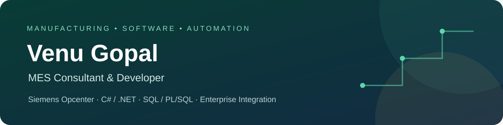

  <a href="https://www.linkedin.com/in/venu-gopal-562a49200/">LinkedIn</a> &nbsp;·&nbsp;
  <a href="mailto:venugopal996639@gmail.com">Email</a> &nbsp;·&nbsp;
  <a href="https://github.com/GorreVenuGopal?tab=repositories">Repositories</a>

## About me

I'm Venu Gopal, an MES consultant and developer based in India. I work with **Siemens Opcenter** to connect manufacturing processes, shop-floor operations, and enterprise systems.

My experience covers requirements gathering, solution design, configuration, custom development, integration, testing, deployment, and production support. I enjoy turning manufacturing requirements into practical software with clear workflows and dependable data.

## Technical focus

| Area | Technologies and experience |
| --- | --- |
| MES development | Siemens Opcenter, Designer, Portal Studio, CDOs, CLFs, transaction extensions, business validations |
| Manufacturing integration | Workflow Designer, Map Designer, MIO/CIO, REST APIs, file and database adapters |
| Application development | C#, .NET, JavaScript, HTML, CSS |
| Databases | Oracle SQL / PL/SQL, SQL Server, stored procedures, data reconciliation |
| Shop-floor connectivity | Ignition SCADA, Python / Jython, OPC UA, PLC and Level-2 interfaces |
| Delivery and quality | URS / FRS, technical design, unit testing, SIT / UAT, validation support, go-live and hypercare |

## What I work on

- **Manufacturing execution:** configurable models, container lifecycle, materials, resources, and WIP processes.
- **Operator experience:** transaction pages, grid editing, defaults, and validations in Portal Studio.
- **System integration:** inbound master data and production data, outbound transactions, retries, and interface monitoring.
- **Data and automation:** SQL / PL/SQL logic, shop-floor data capture, and reconciliation between MES and enterprise systems.
- **Regulated delivery:** experience supporting CSV, GxP, and 21 CFR Part 11 requirements.

Professional work includes pharmaceutical, steel, and glass manufacturing environments. Client source code and internal implementation details are not published here.

## Featured personal project

### Daybook · Personal productivity for Android

An offline-first personal organizer bringing daily planning, learning, wellbeing, and personal records into one customizable app.

**Highlights**

- Day-wise workouts with offline GIF guides, Done / Skip tracking, and editable exercise plans.
- Life Timeline, Skills & Growth, Developer Skills, goals, and habit challenges.
- Reminders, contacts, document wallet, savings and investments, and an encrypted password vault.
- Page themes, customizable tabs, and an editing lock to prevent accidental layout changes.
- Local storage, backups, and optional Google spreadsheet synchronization.

**Built with:** Java · Android WebView · JavaScript · HTML / CSS · WorkManager · Google APIs.

**Status:** personal Android project; Google connection requires owner configuration, and device-specific features need physical-phone validation. The source repository is private. This profile does not publish the app or its personal data.

## Learning and development

I'm continuing to strengthen my skills in:

- C# / .NET application design and maintainable integration services.
- SQL / PL/SQL performance, data quality, and reliable transaction processing.
- Git, automated testing, and software delivery.
- Python, data structures, and practical AI / generative AI applications.

## Education

- **MBA — Business Analytics**
- **B.Sc. — Computer Science**

## Let's connect

I'm interested in MES development, manufacturing integration, industrial automation, and practical software projects.

**[LinkedIn](https://www.linkedin.com/in/venu-gopal-562a49200/)** · **[venugopal996639@gmail.com](mailto:venugopal996639@gmail.com)**

Build with purpose. Learn consistently. Improve one step at a time.

